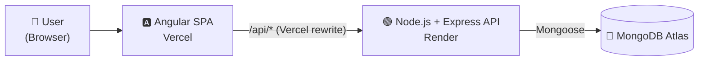

# Shira Beauty — Beauty Institute Management System

A full-stack web app for a beauty institute: customers browse treatments and book available appointment slots, and staff manage treatments and booked appointments.

🔗 **Live demo:** [beauty-institute-management.vercel.app](https://beauty-institute-management.vercel.app)

> ⏳ The backend runs on Render's free tier and sleeps when idle, so the **first load may take up to a minute**. After that it's fast.

---

## 📸 Screenshots

**Home page**


**Treatments list**


**Smart appointment booking**


---

## ✨ Features

- **Treatments catalog** with images, descriptions, duration and price, loaded from MongoDB
- **Add treatment** form that saves new treatments through the REST API
- **Smart appointment booking**: pick a treatment, see only its available slots sorted by date and time, and book with name and phone
- **Booked appointments table** with cancellation (the slot returns to the available list)
- **Special offer banner** that pre-selects a discounted treatment
- **Branches page** with locations and opening hours
- Hebrew, right-to-left UI with client-side routing

---

## 🏗️ Architecture



The Angular app calls relative `/api/...` URLs. A rewrite rule in [`frontend/vercel.json`](./frontend/vercel.json) forwards them to the Express server on Render, so the frontend code needs no environment-specific URLs.

### REST API

| Method | Endpoint | Description |
|---|---|---|
| `GET` | `/api/treatments` | List all treatments |
| `POST` | `/api/treatments` | Add a treatment |
| `GET` | `/api/appointments` | List all appointment slots |
| `POST` | `/api/appointments` | Create an appointment slot |
| `POST` | `/api/appointments/update-status` | Book or cancel a slot |
| `GET` | `/api/branches` | List branches |

---

## 🛠️ Tech Stack

- **Frontend:** Angular · TypeScript · HTML · CSS · RxJS · Angular Router
- **Backend:** Node.js · Express · REST API
- **Database:** MongoDB · Mongoose
- **Hosting:** Vercel (frontend) · Render (backend) · MongoDB Atlas (database)
- **Previously deployed on:** AWS EC2 with a CI/CD pipeline in GitHub Actions

---

## ☁️ Deployment History: AWS EC2 + CI/CD

The project was first deployed to an **AWS EC2** Linux server as part of a cloud course. I built a **GitHub Actions** pipeline ([`deploy.yml`](./.github/workflows/deploy.yml)) that, on every push to `main`:

1. Connects to the EC2 instance over **SSH** using encrypted repository secrets
2. Builds the Angular app and publishes it to the web server root
3. Pulls the latest backend code, installs dependencies and restarts the Node.js server as a **systemd** service

After the AWS free tier ended, I moved the project to Vercel, Render and MongoDB Atlas so it stays online at no cost. The workflow is kept in the repo, disabled, as a reference.

---

## 🚀 Running Locally

**Requirements:** Node.js 20+ and MongoDB (local or Atlas)

**Backend**

```bash
cd server
npm install
npm start          # runs on http://localhost:3000
```

By default the server connects to `mongodb://localhost:27017/beauty_salon_db`. To use another database, set the `MONGO_URI` environment variable.

**Frontend**

```bash
cd frontend
npm install
npx ng serve --proxy-config proxy.conf.json   # runs on http://localhost:4200
```

[`proxy.conf.json`](./frontend/proxy.conf.json) forwards `/api` requests to the local backend on port 3000, the same way `vercel.json` does in production.

---

Built by **Shira Carmi**
